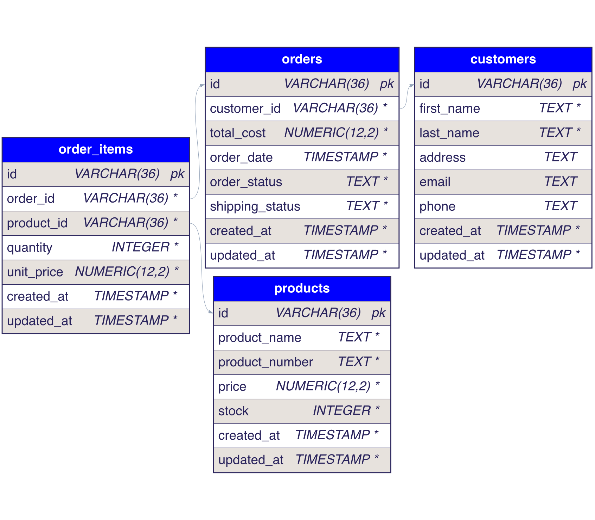

# PostgreSQL Testdatenbank

Diese Ordnerstruktur enthaelt SQL-Skripte fuer eine lokale PostgreSQL-Testdatenbank.

## Struktur

- `schema/001_initial_schema.sql`: Tabellen, Constraints, Indizes und Trigger
- `seeds/001_sample_data.sql`: Kleine Beispiel-Daten fuer lokale Tests
- `migrations/`: Inkrementelle Schema-Aenderungen fuer spaetere Versionen

## Schema-Diagramm



## Ausfuehren

1. Schema einspielen:

```bash
psql -U postgres -d team18 -f db/schema/001_initial_schema.sql
```

2. Beispiel-Daten einspielen:

```bash
psql -U postgres -d team18 -f db/seeds/001_sample_data.sql
```
